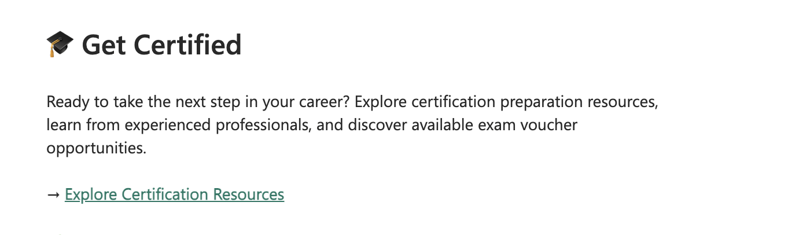
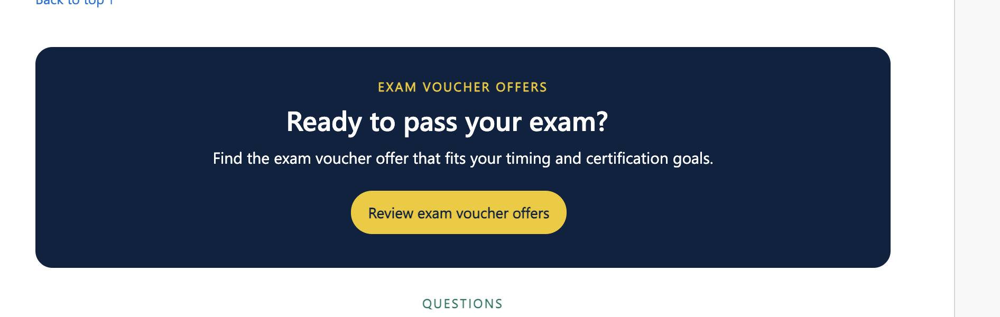
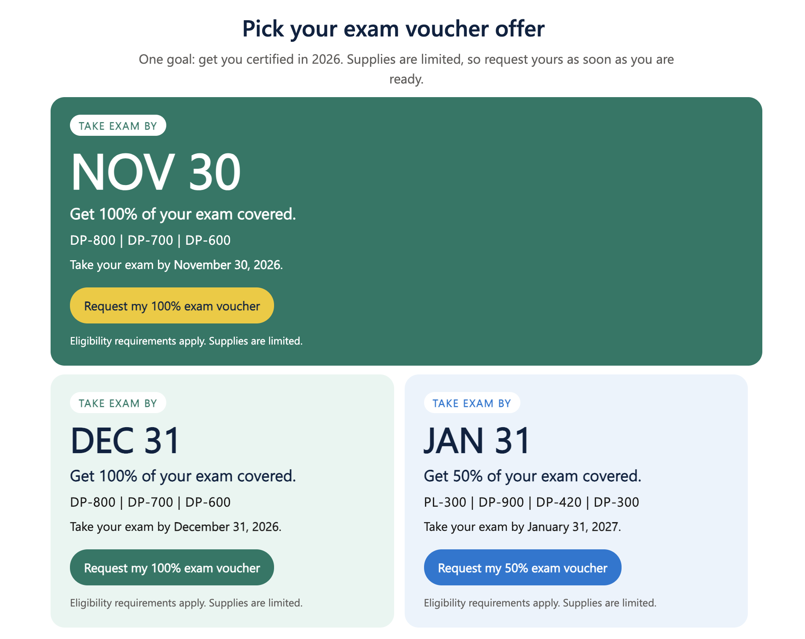

# Data Days: AI @ Work – Exam Voucher Offers

> Data Days runs **November 2 – December 15, 2026**. Vouchers are limited, so request yours as soon as you are ready.

Request an exam voucher through the **Certification Vouchers page** during Data Days. Each person can request **one** exam voucher, and eligibility requirements apply.

## 🗓️ Key Dates

| Event | Date |
|-------|------|
| **Data Days starts** | November 2, 2026 |
| **Data Days ends** | December 15, 2026 |
| **Status** | 🟢 Active |

## ✅ Quick Summary

| Item | Detail |
|------|--------|
| What you do | Register for Data Days, then request a voucher on the Certification Vouchers page |
| Account needed | Free Fabric Community account |
| Limit | One exam voucher per person |
| How you get it | Private message on the Fabric Community (not email) |
| Extensions | Vouchers cannot be extended, so schedule your exam right away |

## 🎯 Voucher Offers

| Take exam by | Coverage | Eligible exams |
|--------------|----------|----------------|
| **November 30, 2026** | 100% | DP-800, DP-700, DP-600 |
| **December 31, 2026** | 100% | DP-800, DP-700, DP-600 |
| **January 31, 2027** | 50% | PL-300, DP-900, DP-420, DP-300 |

## 📋 How to Request

### Step 1 – Register and open Get Certified

1. 
2. Register for Data Days
3. Click **Explore Certification Resources** under **Get Certified**

### Step 2 – Review exam voucher offers

Scroll down to **Ready to pass your exam?** and click **Review exam voucher offers**.

### Step 3 – Pick your offer

On **Pick your exam voucher offer**, choose the offer that matches your exam and timing, then click **Request my exam voucher**.

### Step 4 – Get your voucher

1. Fill out the short request form (a free Fabric Community account is required)
2. Watch your **Fabric Community inbox**. The code arrives by private message, not email
3. Schedule your exam right away and take it by the date on your offer

> Details are based on the official Data Days pages and may change. Check them for the latest eligibility rules and terms.
